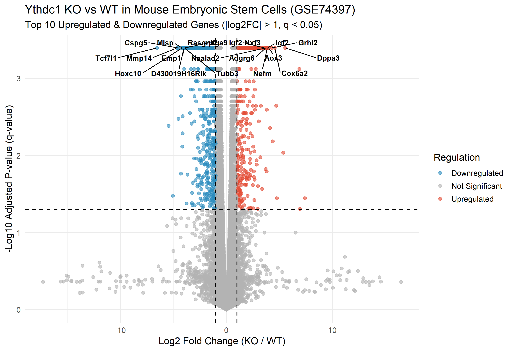
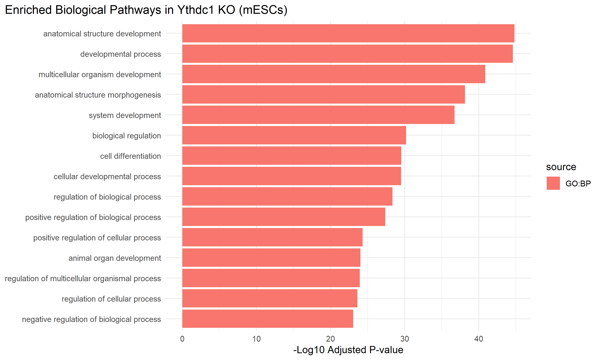
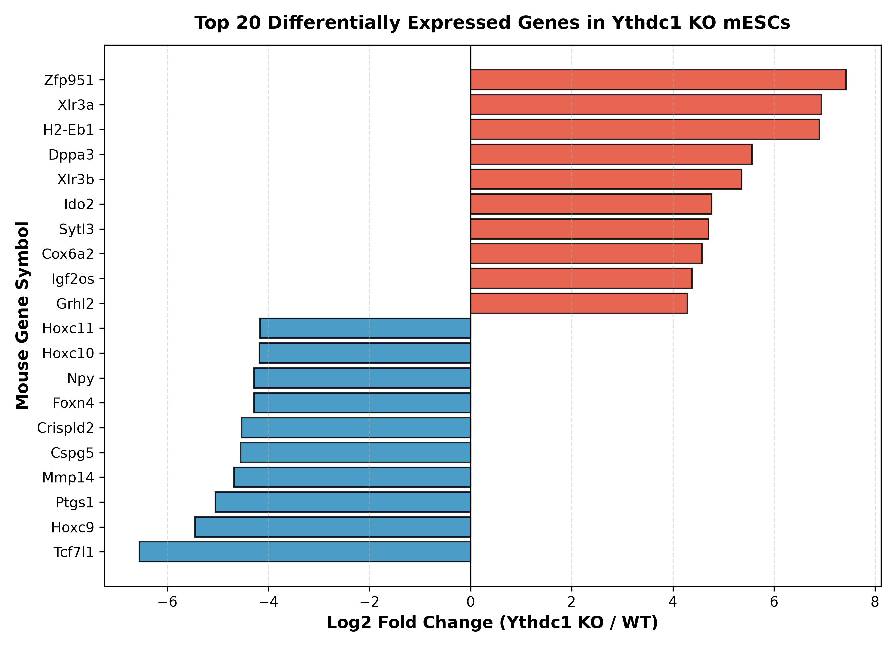
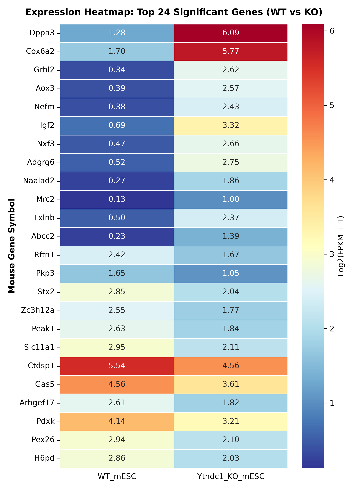

# End-to-End Bulk RNA-Seq Analysis: *Ythdc1* Knockout in Mouse Embryonic Stem Cells

## Project Overview
This repository presents a complete, reproducible bulk RNA-seq bioinformatics workflow investigating the role of the nuclear m6A reader protein **YTHDC1** in mouse embryonic stem cells (**NCBI GEO: GSE74397 / SRA: SRP065329**, Roundtree et al., *eLife* 2017). The pipeline spans raw sequencing quality control and pseudo-alignment in **Linux (WSL2 Ubuntu)**, differential gene expression and Gene Ontology enrichment in **R**, and publication-grade data visualization in **Python**.

---

## Repository Structure
```text
Ythdc1_m6A_RNAseq_Portfolio/
├── data/
│   ├── GSE74397_Ythdc1KO_mESC_RNA-Seq_CuffDiff.xlsx   # Processed CuffDiff expression table
│   └── Significant_DEGs_Ythdc1_KO.csv                 # Filtered DEGs (|log2FC| > 1, q < 0.05)
├── scripts/
│   ├── 01_upstream_salmon_pipeline.sh                 # Linux CLI: SRA -> FastQC -> MultiQC -> Salmon
│   ├── 02_downstream_DEG_enrichment.R                 # R: DEG filtering, ID mapping, Volcano & GO plots
│   └── 03_python_visualizations.py                    # Python: Top-20 DEG bar chart & FPKM heatmap
├── results/
│   ├── multiqc_report.html                            # Aggregated sequencing QC report
│   ├── SRR2830633_quant.sf                            # Salmon transcript-level TPM & count output
│   ├── Ythdc1_KO_Volcano_Plot.png                     # R ggplot2 Volcano Plot
│   ├── Ythdc1_KO_Pathway_Enrichment.png               # R gprofiler2 GO:BP & KEGG enrichment chart
│   ├── Python_Top20_DEGs_BarChart.png                 # Python Matplotlib diverging fold-change chart
│   └── Python_Top24_Expression_Heatmap.png            # Python Seaborn Log2(FPKM + 1) heatmap
└── README.md
```

---

## Pipeline Workflow & Tools Used
1. **Upstream Sequencing QC & Quantification (`Linux / Bash`):**
   * Retrieved paired-end FASTQ reads (`SRR2830633`) via `sra-tools` (`fastq-dump`).
   * Evaluated base quality scores, adapter content, and read integrity using **FastQC** and **MultiQC**.
   * Built a transcriptome index against **GENCODE Mouse M35** and quantified transcript abundances (`TPM` and `NumReads`) using **Salmon** (`--validateMappings`).
2. **Downstream Differential Expression & Functional Analysis (`R`):**
   * Filtered valid CuffDiff tests (`status == "OK"`, finite fold changes) using significance cutoffs of **`|log2FC| > 1`** and **`FDR (q-value) < 0.05`**.
   * Translated NCBI RefSeq IDs (`NM_...`) into official Mouse Genome Informatics (**MGI**) symbols via **gprofiler2** (`gconvert`).
   * Performed functional over-representation analysis (**GO Biological Process & KEGG**) via `gost`.
3. **Comparative Expression Visualization (`Python`):**
   * Mapped RefSeq identifiers via **MyGene.info** (`mygene`) and generated diverging fold-change bar plots and `Log2(FPKM + 1)` expression heatmaps using **pandas**, **Matplotlib**, and **Seaborn**.

---

## Key Biological Findings
* **Pluripotency & Differentiation Disruption:** Loss of *Ythdc1* significantly alters master developmental and stem cell regulators (including *Tcf7l1*, *Dppa3*, and *Grhl2*), aligning with *Ythdc1*'s known role in maintaining mESC identity.
* **Nuclear RNA Export & Developmental Pathways:** Functional enrichment confirms significant over-representation of **cell differentiation**, **anatomical structure development**, and **developmental processes**, consistent with m6A-mediated nuclear mRNA export regulation.

---

## Data Availability & Citation
* **NCBI GEO Series:** [GSE74397](https://nih.gov)
* **NCBI SRA BioProject / Study:** PRJNA300279 / SRP065329 (Run analyzed: `SRR2830633`, `GSM1919520`)
* **Original Publication:** Roundtree, I. A., Luo, G. Z., Zhang, Z., Wang, X., Zhou, T., Cui, Y., Sha, J., Huang, X., Guerrero, L., Xie, P., He, E., Shen, B., & He, C. (2017). YTHDC1 mediates nuclear export of N6-methyladenosine methylated mRNAs. *eLife*, 6, e31311. https://doi.org

  
## Key Visualizations





---

## Tools & Software Dependencies
* **Command-Line / Upstream (Linux / Conda):** `sra-tools`, `FastQC (v0.13.0)`, `MultiQC (v1.35)`, `Salmon (v1.10.3)`
* **R Downstream Analysis:** `readxl`, `gprofiler2` (Kolberg et al., *F1000Research* 2020), `ggplot2`, `ggrepel`
* **Python Visualization:** `pandas`, `numpy`, `matplotlib`, `seaborn`, `mygene`
